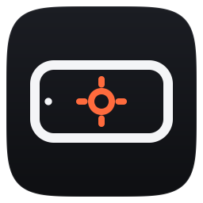
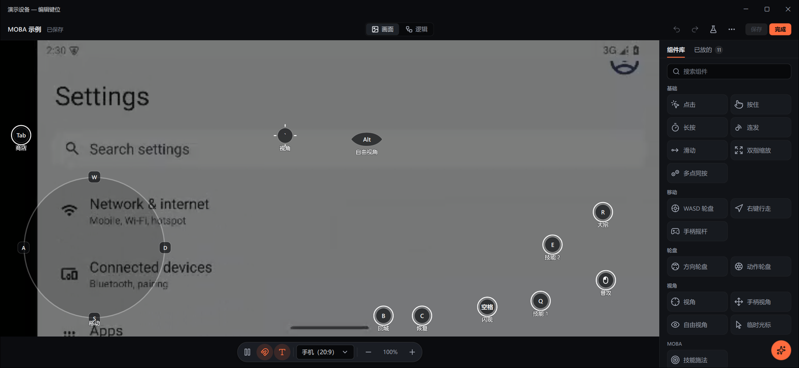
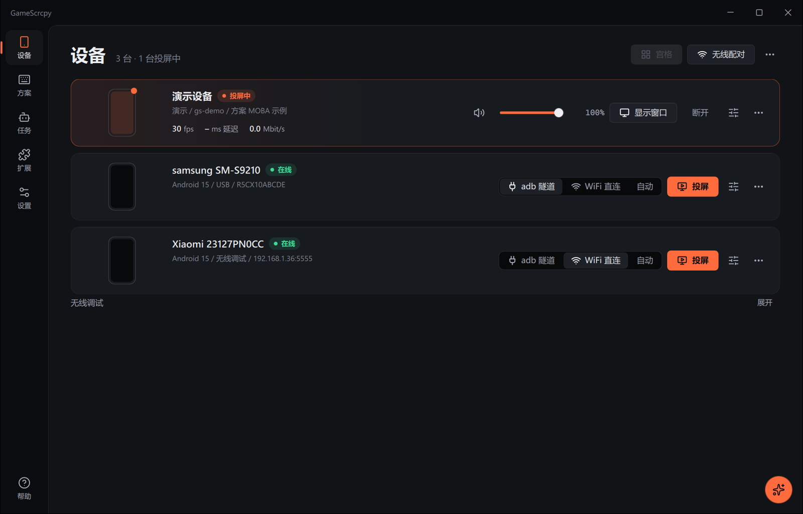
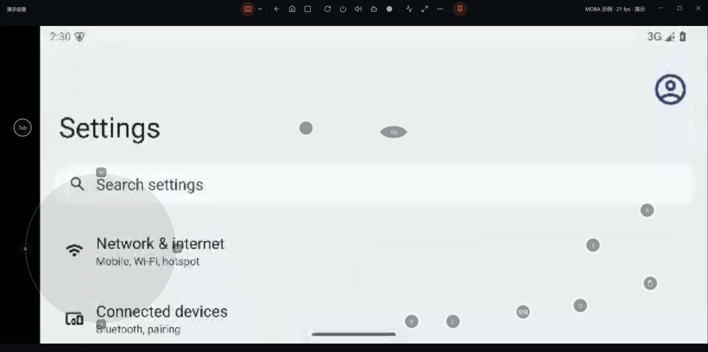
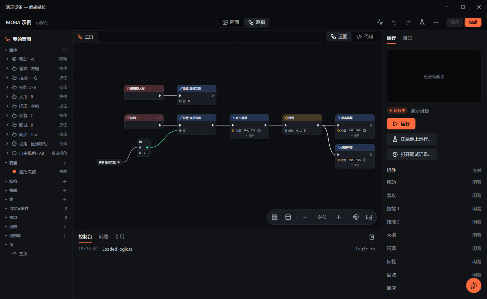

# GameScrcpy

**Play Android games on Windows with a keyboard, a mouse and a gamepad**

[简体中文](README.md) · English

[Download](https://github.com/NuoRan/GameScrcpy/releases/latest) · [User guide](docs/README.md) · [Changelog](CHANGELOG.md) · [Contributing](CONTRIBUTING.en.md)

GameScrcpy mirrors an Android phone to your PC with low latency and lets you play with a keyboard, a mouse and a gamepad, with the keys placed right on the game picture. When keys alone are not enough, you can give them logic as blueprints (nodes and wires) or TypeScript, with image and color search, text recognition and scheduled tasks. The phone-side server, the protocol and the PC app were all written from scratch for this version; the idea comes from [scrcpy](https://github.com/Genymobile/scrcpy).

The user interface is available in Simplified Chinese and English.

## Features

### Mirroring

- **Low latency**: hardware decoding on the graphics card, with decoded pictures handed to the interface without a memory copy; H.264, H.265 and AV1.
- **Audio**: plays the phone's sound on the PC (Android 11 and later).
- **Connections**: USB cable; wireless debugging, paired with a code or a QR code; the picture can also travel over WiFi direct (UDP with error correction, resuming by itself after a dropout).
- **Several phones**: one window each, or all of them in a grid; mirror input to all of them, or open an app, install an APK, send files or run a task on the selected ones.
- **Recording**: records the picture, the sound and your input, exports MP4, and replays recordings to test logic.
- **Phone tools**: files, apps, a status overlay, and apps launched on a separate virtual display; measures the real latency from a key press to the change on screen.
- **Companion app**: an optional phone app that shows the cursor and key hints on the phone, lets you type into the phone with the PC's keyboard and connects over Wi-Fi by scanning a QR code; its switches can be changed on the phone or on the PC, and both sides stay in sync.

### Key mapping

- **Keys on the picture**: open the editor in the mirror window, drag components onto the game's buttons, bind keys and try them right away.
- **Components**: tap, hold, long press, turbo, swipe, pinch, WASD stick, right-click walk, view, free look, skill, direction wheel, multi-press, action wheel, temporary cursor, plus gamepad stick and gamepad view.
- **Per-game profiles**: one profile per game, switched automatically when the game in front changes; each phone remembers its own choice.
- **Gamepads**: Xbox, PlayStation and Switch Pro controllers can drive the keys of a profile, or be handed straight to the game (experimental).
- **Sharing**: export a profile as a file, or pack a profile together with its logic and pictures.

### Blueprints and scripts

- **Blueprints are code**: each key has its own file, and its nodes and wires are the same thing as its TypeScript, so you can switch between the two at any time; shared functions live in a function library that every page can call.
- **Vision**: find pictures and colors on the phone's screen, and read text with the OCR built into Windows.
- **Tasks**: automations that run on a schedule or on demand.
- **Debugging**: breakpoints, stepping and live values; test against a recording without a phone.
- **`gs` command line**: create profile folders, type-check, test against recordings; the script API is documented in [`sdk/docs`](sdk/docs/README.md).

### AI

- **AI assistant**: in the corner of the main window and of every editor, it sees what you are working on and helps you write blueprints, explains blocks and sorts out connection problems. It uses your own OpenAI- or Anthropic-compatible endpoint and key; the key is kept in the Windows Credential Manager.
- **Local MCP server**: lets AI tools such as Claude or Cursor read and write profiles and blueprints, run tests and look at recordings.

### Touch backends and hardware

- **USB debugging**: the default, no extra hardware needed.
- **AOA**: the phone takes the PC for a USB touch screen and works without USB debugging (experimental).
- **Touch boxes**: a small board from an extension acts as the phone's touch screen and keyboard, so the phone works without USB debugging. The ESP32 touch box is now the community extension `community.esp32`, published in its own project, GameScrcpy-ESP32; GameScrcpy itself does not include it (experimental).
- **Capture cards**: shows the picture of an HDMI capture card, with touch through AOA or a touch box (experimental).

### Extensions

- **`.gsext` packages**: themes, picture filters, profiles and patches, logic extensions and native DLL extensions. They can also bring devices such as touch boxes, new ways to connect phones, places pictures and sound come from and go to, reading aloud and voice commands, interface languages, AI model services, and importing and exporting other formats. GameScrcpy comes with no extensions.
- **Safety**: an extension can do only what you allow. Packages can be signed and show a verified publisher; restricted native extensions run in a separate process without any rights, and native code is checked before it installs; `gamescrcpy://` links on web pages install extensions directly.
- **Bundles and upkeep**: a `.gsbundle` installs a set of extensions at once; extensions can be checked for updates; each card shows the extension's health, and you can find out step by step which one causes a problem.
- **Development**: the [guide to writing extensions](docs/extensions/README.en.md) covers the manifest, the logic and native interfaces, testing, signing and publishing; the C interface header is [`sdk/include`](sdk/include/gamescrcpy_ext.h), samples are in [`examples`](examples); `gs ext` tests an extension without GameScrcpy or a phone.

### Interface

- Dark first, with a light theme and six accent colors; a command palette (Ctrl+K) and customizable shortcuts.
- Illustrated built-in help (F1) and guided tours.
- An installer and a portable build.

## Screenshots

| Devices | Mirror window |
|:---:|:---:|
|  |  |
| **Key mapping editor** | **Blueprint** |
|  |  |

## Requirements

| | |
|:--|:--|
| PC | Windows 10 / 11, 64-bit; a graphics card with Direct3D 11 is recommended (without one, the processor decodes and draws, which may stutter) |
| Phone | Android 9 or later; audio and wireless pairing need Android 11 or later |
| Connection | A USB cable, or Wi-Fi on the same network as the PC |

## Download and install

Download one of these from [Releases](https://github.com/NuoRan/GameScrcpy/releases/latest):

- **Installer** `GameScrcpy-<version>-setup.exe`: installs for the current user without administrator rights; uninstalling keeps your settings, profiles and logs (in `%APPDATA%\GameScrcpy`).
- **Portable** `GameScrcpy-<version>-portable.zip`: unzip and run `GameScrcpy.exe`; data stays in the `data` folder next to it.

Both include everything they need (adb too); there is no Android SDK or Visual C++ runtime to install. The program is not code-signed yet, so Windows may say "Windows protected your PC" the first time: choose "More info", then "Run anyway".

## Getting started

1. On the phone, turn on "Developer options" and "USB debugging". The guide shown at first launch has the steps for each phone brand.
2. Connect the phone with a USB cable and allow USB debugging on the phone.
3. On the Devices page, choose "Mirror".
4. In the mirror window's toolbar, open "Edit key mapping", drag components onto the game's buttons and bind keys.
5. Press F1 for the illustrated help on the mirror window, the key mapping editor, profiles, scripts, extensions and common questions.

## Documentation

| Topic | Where |
|:--|:--|
| User guide (the same pages as F1 in the app) | [docs/README.md](docs/README.md) |
| Script API | [sdk/docs](sdk/docs/README.md) |
| Writing extensions | [docs/extensions](docs/extensions/README.en.md) |
| Architecture | [docs/architecture.md](docs/architecture.md) |
| Protocol | [protocol/SPEC.md](protocol/SPEC.md) |
| Building from source and contributing | [CONTRIBUTING.en.md](CONTRIBUTING.en.md) |

## Feedback

- Bugs and ideas: [Issues](https://github.com/NuoRan/GameScrcpy/issues). Attach the file made by "Settings > About > Export diagnostics" when reporting a problem.
- Report security issues privately as described in [SECURITY.md](SECURITY.md).

## Sponsoring

GameScrcpy is free and open source. If it helps you, you can support its development on [Afdian](https://afdian.com/a/GameScrcpy).

## License and acknowledgements

GameScrcpy is released under the [Apache License 2.0](LICENSE).

- [scrcpy](https://github.com/Genymobile/scrcpy): the pioneer of Android mirroring, where the idea of GameScrcpy comes from.
- [QtScrcpy](https://github.com/barry-ran/QtScrcpy): the base of GameScrcpy 1.x.
- The third-party components (Qt, FFmpeg, dav1d, SDL, libusb, QuickJS-ng, TypeScript, QWindowKit, nlohmann/json, miniz, QR Code generator, Lucide, doctest, tl::expected), their versions and licenses are listed in [third_party/README.md](third_party/README.md) and in the app under "Settings > About > Open-source licenses".
