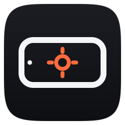
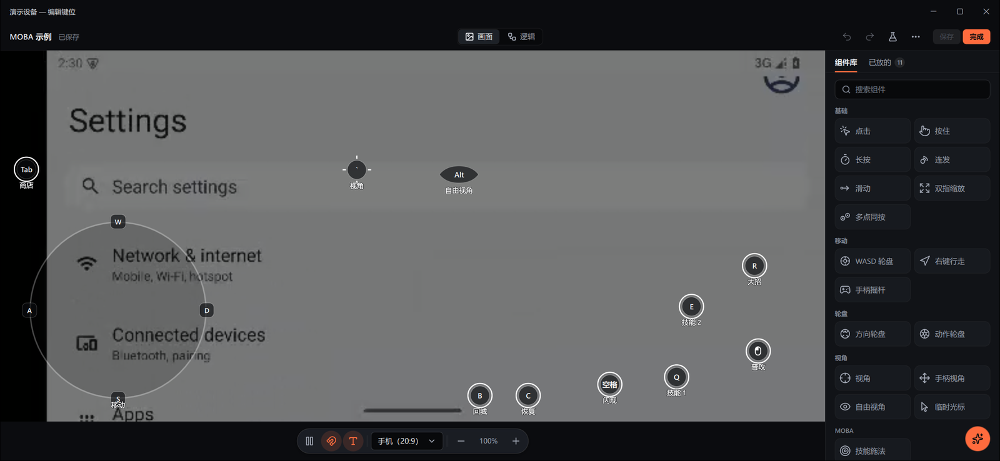
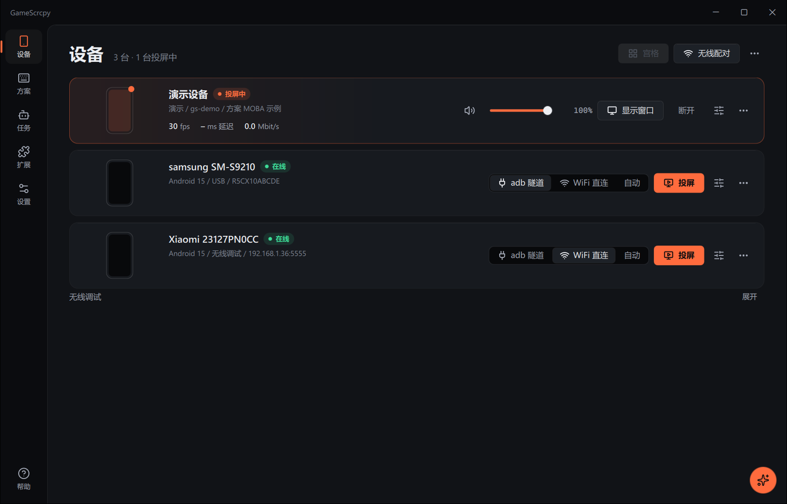
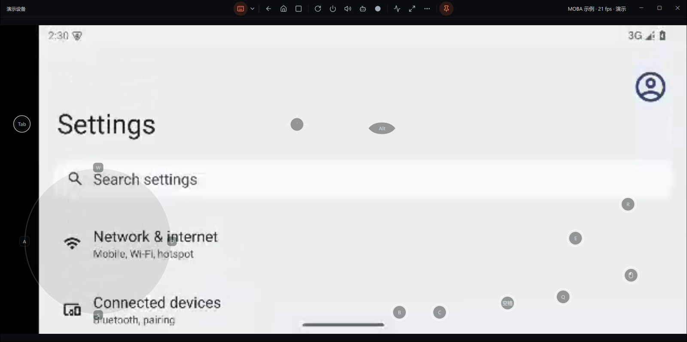
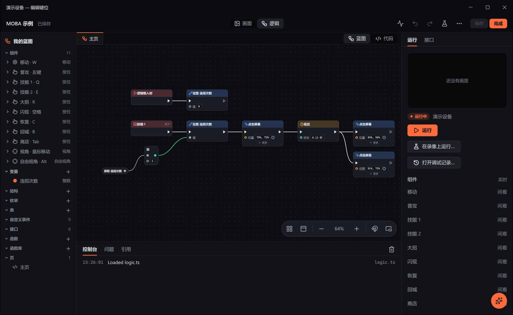

# GameScrcpy

**在 Windows 上用键盘、鼠标和手柄玩安卓手机游戏**

简体中文 · [English](README.en.md)

[下载](https://github.com/NuoRan/GameScrcpy/releases/latest) · [使用帮助](docs/README.md) · [更新日志](CHANGELOG.md) · [参与开发](CONTRIBUTING.md)

GameScrcpy 把安卓手机的画面低延迟地投到电脑上，键位直接摆在游戏画面上，用键盘、鼠标和手柄操作。键位不够用时，可以用蓝图（节点和连线）或 TypeScript 给它们写逻辑，识图、找色、定时任务都能做。手机端服务、通信协议和电脑端全部是这一版重新写的，思路源自 [scrcpy](https://github.com/Genymobile/scrcpy)。

## 功能

### 投屏

- **低延迟**：显卡硬件解码，解码出的画面直接交给界面显示，不经过内存拷贝；支持 H.264、H.265、AV1。
- **声音**：在电脑上播放手机的声音（Android 11 及以上）。
- **多种连接**：USB 数据线；无线调试，用配对码或扫二维码配对；画面也可以走 WiFi 直连（UDP 加纠错，断线后自动续上）。
- **多台手机**：每台一个窗口，或者放进宫格里一起看；可以同步操作，也能对选中的几台一起打开应用、安装 APK、发送文件或运行任务。
- **录像**：录下画面、声音和你的操作，导出 MP4，也能拿来回放测试逻辑。
- **手机管理**：文件管理、应用管理、状态浮层，把应用开在单独的虚拟屏幕上；还能测出从按键到画面变化的真实延迟。
- **手机伴侣**：可选装的手机应用，在手机上显示光标和键位提示，让你用电脑键盘往手机里打字，扫码就能经 Wi-Fi 连上电脑；它的开关在手机和电脑上都能改，两边同步。

### 键位映射

- **在画面上摆键位**：在投屏窗口里打开编辑器，把组件拖到游戏按钮上、配好按键，随时"试一试"。
- **组件库**：点击、按住、长按、连发、滑动、双指缩放、WASD 轮盘、右键行走、视角、自由视角、技能、方向轮盘、多点同按、动作轮盘、临时光标，以及手柄摇杆与手柄视角。
- **按游戏自动切换**：每个游戏一套方案，前台换了游戏就自动换方案；每台手机记住自己的选择。
- **手柄**：Xbox、PlayStation、Switch Pro 手柄可以驱动方案里的键位；也可以把手柄直接交给游戏（实验性）。
- **分享**：方案导出成文件，带逻辑和图片的方案可以整个打包。

### 蓝图与脚本

- **蓝图就是代码**：每个键位一个文件，节点与连线和 TypeScript 是同一份内容，两边随时切换；公共函数放进函数库，任何页都能调用。
- **识图与文字识别**：在手机画面里找图、找色，用 Windows 自带的 OCR 识别文字。
- **任务**：按时间表或手动运行的自动化流程。
- **调试**：断点、单步、看变量；不连手机也能用录像回放测试。
- **命令行工具 `gs`**：新建方案文件夹、类型检查、回放测试；脚本接口文档见 [`sdk/docs`](sdk/docs/README.md)。

### AI

- **AI 小助手**：在主窗口和各个编辑窗口的右下角，看得到你正在编辑的内容，可以帮你写蓝图、解释节点、排查连接问题。接你自己的 OpenAI 或 Anthropic 兼容接口与密钥，密钥存在 Windows 凭据管理器里；也可以用扩展提供的模型服务。
- **本地 MCP 服务**：让 Claude、Cursor 等 AI 工具直接读写方案和蓝图、运行测试、查看录像。

### 触控方式与硬件

- **USB 调试**：默认方式，不需要额外硬件。
- **AOA**：手机把电脑当成一块 USB 触摸屏，不打开 USB 调试也能操作（实验性）。
- **触控盒**：扩展提供的小板子扮成手机的触摸屏和键盘，不开 USB 调试也能操作。ESP32 触控盒现在是社区扩展 `community.esp32`，在单独的项目 GameScrcpy-ESP32 里发布，GameScrcpy 本身不包含它（实验性）。
- **采集卡**：显示 HDMI 采集卡的画面，配合 AOA 或触控盒操作（实验性）。

### 扩展

- **扩展包 `.gsext`**：主题、画面滤镜、键位方案与补丁、逻辑扩展、原生 DLL 扩展；还能带来触控盒等设备、连接手机的新方式、画面与声音的来源和去处、朗读与语音命令、界面语言、AI 模型服务，以及导入导出别的格式。GameScrcpy 不自带扩展。
- **安全**：扩展只能做你允许的事。扩展包可以签名，GameScrcpy 记住发布者的公钥，换了公钥或去掉签名的更新不予安装；受限的原生扩展在没有任何权限的独立进程里运行，安装前有安全检查；网页上的 `gamescrcpy://` 链接可以下载扩展包，核对 SHA-256 后打开安装框。
- **整合包与维护**：整合包 `.gsbundle` 一次装好一组扩展；可以检查扩展更新；扩展卡片显示健康状况，出了问题可以一步步找出是哪一个。
- **开发**：[扩展开发指南](docs/extensions/README.md)讲清单、逻辑与原生接口、测试、签名和发布；C 接口头文件在 [`sdk/include`](sdk/include/gamescrcpy_ext.h)，示例在 [`examples`](examples)；`gs ext` 不开 GameScrcpy、不连手机就能测试扩展。

### 界面

- 深色优先的界面，可选浅色主题与六种强调色；命令面板（Ctrl+K）和可自定义的快捷键。
- 内置图文帮助（F1）与新手引导；中文与英文界面，语言包扩展可以添加更多语言。
- 安装包与便携版两种发布形式。

## 截图

| 设备页 | 投屏窗口 |
|:---:|:---:|
|  |  |
| **键位编辑器** | **蓝图** |
|  |  |

## 系统要求

| 项目 | 要求 |
|:--|:--|
| 电脑 | Windows 10 / 11，64 位；建议使用支持 Direct3D 11 的显卡（没有可用显卡时由处理器解码和绘制，可能会卡） |
| 手机 | Android 9 或更高版本；声音与无线配对需要 Android 11 或更高版本 |
| 连接 | USB 数据线，或与电脑在同一局域网的 Wi-Fi |

## 下载与安装

从 [Releases](https://github.com/NuoRan/GameScrcpy/releases/latest) 下载其中一种：

- **安装包** `GameScrcpy-<版本>-setup.exe`：默认只为当前用户安装，不需要管理员权限；卸载时保留你的设置、方案和日志（在 `%APPDATA%\GameScrcpy`）。
- **便携版** `GameScrcpy-<版本>-portable.zip`：解压后直接运行 `GameScrcpy.exe`，数据存在旁边的 `data` 文件夹里。

两种都自带运行所需的一切（包括 adb），不用另装 Android SDK 或 VC++ 运行库。程序暂时没有代码签名，第一次运行时 Windows 可能提示"Windows 已保护你的电脑"：点"更多信息"，再点"仍要运行"。

## 快速开始

1. 在手机上打开"开发者选项"和"USB 调试"。第一次启动时的引导会按手机品牌告诉你怎么开。
2. 用数据线连接手机，在手机上允许 USB 调试。
3. 在"设备"页点"投屏"。
4. 在投屏窗口的工具栏里打开"编辑键位"，把组件拖到游戏按钮上、配好按键。
5. 按 F1 打开帮助，里面有投屏窗口、键位编辑器、方案、脚本、扩展与常见问题的图文说明。

## 文档

| 内容 | 位置 |
|:--|:--|
| 使用帮助（与程序里 F1 打开的是同一份） | [docs/README.md](docs/README.md) |
| 脚本接口 | [sdk/docs](sdk/docs/README.md) |
| 扩展开发 | [docs/extensions](docs/extensions/README.md) |
| 架构概览 | [docs/architecture.md](docs/architecture.md) |
| 通信协议 | [protocol/SPEC.md](protocol/SPEC.md) |
| 从源码构建与参与开发 | [CONTRIBUTING.md](CONTRIBUTING.md) |

## 反馈与交流

- 问题与建议：[Issues](https://github.com/NuoRan/GameScrcpy/issues)。报告问题时附上程序里"设置 > 关于 > 导出诊断包"生成的文件，能更快找到原因。
- 安全问题请按 [SECURITY.md](SECURITY.md) 私下报告。
- QQ 交流群：762961615

## 赞助

GameScrcpy 免费、开源。如果它帮到了你，欢迎在[爱发电](https://afdian.com/a/GameScrcpy)支持后续开发。

## 许可证与致谢

GameScrcpy 以 [Apache License 2.0](LICENSE) 发布。

- [scrcpy](https://github.com/Genymobile/scrcpy)：安卓投屏的先驱，GameScrcpy 的思路源自它。
- [QtScrcpy](https://github.com/barry-ran/QtScrcpy)：GameScrcpy 1.x 的基础。
- 用到的第三方组件（Qt、FFmpeg、dav1d、SDL、libusb、QuickJS-ng、TypeScript、QWindowKit、nlohmann/json、miniz、QR Code generator、Lucide、doctest、tl::expected）及其版本与许可证见 [third_party/README.md](third_party/README.md)，程序里在"设置 > 关于 > 开源许可"。
