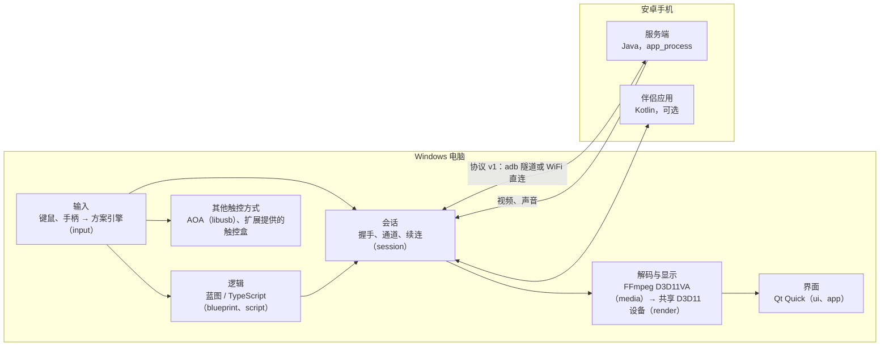

# 架构概览

> In short: a Qt Quick app on Windows talks to its own Java server on the phone over a binary protocol shared by both sides. Video is decoded on the graphics card and drawn by Qt Quick on the same Direct3D 11 device; input goes through a profile engine and, when a profile has logic, through TypeScript running in QuickJS. All modules except the interface layer are plain C++ without Qt.

## 整体

## 进程

| 进程 | 作用 |
|:--|:--|
| `GameScrcpy.exe` | 主程序：界面、设备会话、解码与显示、键位映射、方案逻辑、本地 MCP 服务、AI 小助手 |
| `gs.exe` | 命令行工具：新建方案文件夹、类型检查、回放测试、生成脚本接口文件、MCP 中继 |
| `gs-exthost.exe` | 加载原生 DLL 扩展的单独进程，一个扩展崩溃不影响主程序 |
| `gs-scripthost.exe` | 在低权限沙箱里运行扩展带来的逻辑 |
| 手机端服务端 | 由 adb 推到手机、经 `app_process` 以 shell 身份运行：采集画面与声音并用 MediaCodec 编码、注入触控与按键、剪贴板、应用与文件操作；断开后自己清理退出 |
| 伴侣应用 | 可选装的安卓应用：手机上的光标与键位提示、输入法、扫码连接 |

ESP32 触控盒（固件、刷写与板子的协议）在 2.1 改为社区扩展 `community.esp32`，单独的项目 GameScrcpy-ESP32，只用公开的扩展接口：触控方式、设备提供者、长任务、事件、设置、面板与硬件占用。

## 电脑端模块（`src/`）

核心层的模块都是不依赖 Qt 的 C++20，可以用 `core-only` 预设单独构建和测试；只有 `render`、`ui`、`app` 用 Qt。

| 模块 | 职责 |
|:--|:--|
| `base` | 只用标准库的基础设施：`Expected` 错误类型、日志、时钟、字节序、单生产者单消费者队列、线程检查 |
| `platform` | Windows 相关的最底层：套接字、CNG 加密、文件、USB（libusb，AOA 用）；公开头文件里不出现 Windows 头文件 |
| `protocol` | 通信协议 v1 的编解码，与安卓端 `android/protocol` 共用 `protocol/vectors/` 里的金标准测试向量 |
| `adb` | 原生的 adb 主机协议客户端：设备跟踪、shell、推送文件、端口转发；除启动 adb 服务外不调用 `adb.exe` |
| `session` | 设备会话：推送并启动服务端、握手、打开各个通道、保活与续连；传输方式有 adb 隧道和 WiFi 直连（画面走 UDP 加纠错，控制走自研的轻量可靠通道） |
| `media` | 用 FFmpeg 解码视频（D3D11VA 硬件解码，失败时软解）与声音，声音经 WASAPI 播放 |
| `render` | 应用自建的 Direct3D 11 设备，解码器与 Qt Quick 共用；解码出的画面直接被界面采样，不经过内存拷贝 |
| `input` | 输入源（键盘、鼠标、手柄）、方案格式 v2、坐标换算（锚点加短边单位）与把按键变成触控帧的映射引擎 |
| `hardware` | 设备扩展点：扩展访问串口、HID 与低功耗蓝牙设备的统一接口 |
| `capture` | 采集卡：Media Foundation 采集画面与声音、自动裁掉黑边 |
| `record` | 录像：录下画面、声音与操作，导出 MP4，回放时提供录下的画面给识图 |
| `vision` | 识图：模板匹配、找色、积分图与 SIMD 加速 |
| `tsstrip` | 去掉 TypeScript 的类型标注，让逻辑直接在 QuickJS 里运行 |
| `blueprint` | 蓝图：把 TypeScript 解析成节点与连线、把对蓝图的编辑写回代码，两边始终是同一份内容 |
| `script` | 脚本运行时：QuickJS-ng 引擎（每个会话一个）、接口表、确定性回放、生成类型声明与接口文档 |
| `scripthost`、`exthost` | 与两个子进程通信的管道协议、沙箱与宿主 |
| `ext` | 扩展的清单、版本、依赖与权限 |
| `cli` | `gs.exe` |
| `ui` | QML 模块：设计令牌（`theme`）、图标（`icons`，由 Lucide 生成）、组件库（`controls`）、蓝图画布（`blueprint`） |
| `app` | `GameScrcpy.exe`：窗口与页面、视图模型、设置与方案的存储、命令系统、MCP 服务、AI 服务、帮助 |

## 安卓端（`android/`）

| 模块 | 说明 |
|:--|:--|
| `protocol` | 协议的 Java 实现，测试读取与 C++ 相同的金标准向量 |
| `server` | 服务端，纯 Java（不带 Kotlin 标准库）；发布版 APK 不到 200 KB |
| `companion` | 伴侣应用，Kotlin |

## 几条贯穿全局的设计

- **协议两端一致**：协议改动先改 `protocol/SPEC.md`，再改向量生成器 `protocol/tools/gen_vectors.py`，C++ 与 Java 两边的测试都要逐字节通过。
- **不靠固定延时同步**：产品代码里不 sleep、不用带延时的单发定时器；设备状态来自服务端的消息，而不是解析命令输出。源码规则检查（`tools/check_source_rules.py`）会拦下这两类写法。
- **线程**：界面、解码、输入与每个会话的逻辑各在自己的线程；按键到触控帧在输入线程上完成，不受界面卡顿影响。
- **蓝图就是代码**：方案逻辑只存 TypeScript（每个键位一个文件、函数库一个文件），蓝图是它的另一种显示与编辑方式，不另存一份图。
- **数据位置**：设置、方案与日志在 `%APPDATA%\GameScrcpy`；便携版（程序旁有 `portable.flag`）存在程序旁的 `data` 文件夹。
- **依赖入库**：第三方依赖固定版本放在 `third_party/`，配置阶段不联网。
